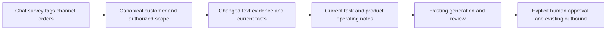

# CRM Standard — approved parent PRD

## Goal and boundaries
Complete generic CRM, lightweight sourced customer context, product-aware reviewed generation, single-host deployment. Independent private repository; only deployment target 49.232.57.128 / crm.qianlan333.cloud. Finish and verify capability before resetting test host. No current V4 release workstation or other host changes.

OneID: read canonical customers, never provision or guess identity. Persistence: customer-owned context projection, product-owned private operating notes, original PostgreSQL UoW and audit. Recoverable work: existing River; model calls and outbound effects preserve existing acceptance/unknown semantics.

## Minimal behavior
- Only five source categories; text only. Historical paging on first use, incremental refresh for changed sources. No full-population AI sweep.
- Every source retains reference, author role, occurred time, coverage and current/historical status. Keep raw facts authoritative. Never make an unavailable source mean absent facts.
- Cache text evidence separately from current order/channel/tag facts; task-specific product recommendations are not permanent customer attributes.
- Current employee visibility applies before summarization and generation. Human profile corrections remain independent.
- Use existing admin and sidebar design/components through Product Design; no new independent portrait, knowledge or strategy UI.
- Product private operating notes augment current product/SKU facts, never public descriptions or prices.
- One context/generation consumption path for scheduled manual-review runs and sidebar assistance. Providers remain disabled until configured.

## Package and clean host
Docker Compose: PostgreSQL16, API and Caddy; optional worker and local Excel component/SQLite. test2g starts only db/api/proxy, all providers/background work off. standard4g/8g keep the same code with resource profiles. Build locally under Linux; no target-host compilation.
Fresh volume, schema/system defaults and one new administrator; all enterprise/business/integration data empty. Secrets generated fresh and excluded from Git. Clean only confirmed old CRM resources on authorized target after artifacts pass checks.

## References and reuse
- https://docs.getdbt.com/docs/build/incremental-models : update changed records, preserve identity and source history.
- https://learn.microsoft.com/en-us/microsoft-sales-copilot/email-reply-premium : CRM-grounded drafts with human review.
- Existing CRM GenerationContextReader, MessageArchive paging/StaffUserID, Automation generation/EER and review plan, Sidebar AI operations.

## Product Design
Target: existing CRM admin product editor/customer profile and sidebar AI operations, preserving layout, typography, colors and navigation. Scope: inline operating-notes field, scoped context/coverage and same-host assistance. Use the existing code target; no redesign or new application framework. Verify mounted pages in Browser and run design QA.

## Acceptance
History beyond latest20; late-arriving changes; role attribution; contradictory evidence; missing orders != no purchase; cross-staff rejection; current product/SKU/retirement; prompt data cannot override rules; duplicate refresh/generation; restart persistence; empty clean installation; HTTPS/login/pages; zero business data and external/background activity in final test2g deployment.
